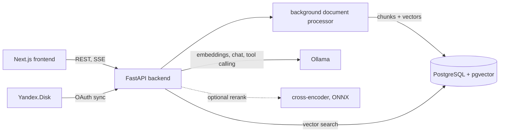

# High-Precision RAG Chunking Engine

[](https://github.com/disorki/High-Precision-RAG-Chunking-Engine/actions/workflows/ci.yml)
[](https://opensource.org/licenses/MIT)

> *Read this documentation in [Russian](README.ru.md)*

A RAG (Retrieval-Augmented Generation) system for searching and answering questions over your own documents. Everything runs locally: embeddings and generation go through Ollama (Qwen 2.5, nomic-embed-text), vectors live in PostgreSQL with pgvector, and no data leaves the machine.

Detailed engine documentation: [CORE_ENGINE.md](CORE_ENGINE.md).

## Features

- **Document ingestion.** PDF, DOCX (tables are converted to Markdown-like text to keep their structure), XLSX (one table per sheet), TXT with encoding detection, and ZIP / RAR archives. Processing runs in the background with stage-by-stage progress.
- **Chunking and embeddings.** Recursive splitting with overlap, optional LLM-generated context headers per chunk, parallel embedding generation with bounded concurrency and retries.
- **Two-stage retrieval.** Cosine search in pgvector with a similarity threshold, then optional reranking of candidates with a cross-encoder exported to ONNX for faster CPU inference.
- **Chat with streaming.** Answers grounded in retrieved chunks with page references, streamed to the client over SSE, with chat session history.
- **Tool-calling agent.** The model decides which tools to call and in what order through Ollama's native tool calling (`/api/chat` with `tools`), loops until it has enough evidence, then answers with citations. Seven tools:

  | Tool | What it does |
  |------|--------------|
  | `search_all` | Semantic search across all documents |
  | `search_document` | Semantic search inside one document |
  | `list_documents` | Ready documents with ids and page counts |
  | `get_document_info` | Document metadata: pages, chunks, status, upload date |
  | `summarize` | Summary of a document, optionally focused on a topic |
  | `compare_documents` | Evidence from several documents on one aspect, for comparison |
  | `extract_facts` | Exact facts (dates, amounts, terms) as JSON via structured output (`format` = JSON schema) |

  Tool errors and malformed arguments are returned to the model so it can correct the call; an iteration cap forces a final answer from the evidence collected so far. The response includes the trace of tool calls.
- **Yandex.Disk sync.** OAuth 2.0, background synchronization on a schedule, new and changed files go straight into the pipeline.

## Architecture



| Component | Stack |
|-----------|-------|
| Backend | Python, FastAPI, SQLAlchemy, Alembic, httpx, LangChain text splitters, APScheduler |
| Retrieval | PostgreSQL + pgvector, sentence-transformers cross-encoder, ONNX Runtime |
| LLM | Ollama: `qwen2.5` for generation and the agent, `nomic-embed-text` for embeddings |
| Frontend | Next.js 14, React, Tailwind CSS |
| Infrastructure | Docker Compose, GitHub Actions |

## Running

Requirements: Docker and Docker Compose, 16 GB RAM or more. An NVIDIA GPU with the NVIDIA Container Toolkit is strongly recommended for Ollama.

```bash
git clone https://github.com/disorki/High-Precision-RAG-Chunking-Engine.git
cd High-Precision-RAG-Chunking-Engine
docker compose up --build -d

docker exec -it rag-ollama ollama pull qwen2.5:7b
docker exec -it rag-ollama ollama pull qwen2.5:14b   # agent model (AGENT_MODEL)
docker exec -it rag-ollama ollama pull nomic-embed-text
```

Open `http://localhost:3000`, upload documents or connect Yandex.Disk, and ask questions in the "Document" or "All documents" tabs.

Ask the agent directly:

```bash
curl -X POST http://localhost:8000/api/agent/chat \
  -H "Content-Type: application/json" \
  -d '{"question": "Compare the payment terms in the two contracts"}'
```

## Local development and tests

```bash
cd backend
python -m venv venv && source venv/bin/activate
pip install -r requirements.txt
uvicorn app.main:app --reload

python -m pytest -q tests
```

The tests cover the agent loop (tool execution, feeding results back, error handling, iteration cap, source deduplication) with a scripted LLM, and check that every declared tool schema matches its handler.

## License

MIT.
