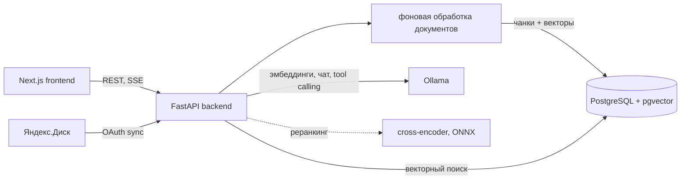

# High-Precision RAG Chunking Engine

[](https://github.com/disorki/High-Precision-RAG-Chunking-Engine/actions/workflows/ci.yml)
[](https://opensource.org/licenses/MIT)

> *Read this documentation in [English](README.md)*

RAG-система (Retrieval-Augmented Generation) для поиска и ответов на вопросы по своим документам. Всё работает локально: эмбеддинги и генерация идут через Ollama (Qwen 2.5, nomic-embed-text), векторы хранятся в PostgreSQL с pgvector, данные не покидают машину.

Подробное описание ядра: [CORE_ENGINE.ru.md](CORE_ENGINE.ru.md).

## Возможности

- **Загрузка документов.** PDF, DOCX (таблицы переводятся в Markdown-подобный текст с сохранением структуры), XLSX (каждый лист — отдельная таблица), TXT с определением кодировки, архивы ZIP и RAR. Обработка идёт в фоне с прогрессом по этапам.
- **Чанкинг и эмбеддинги.** Рекурсивное разбиение с перекрытием, необязательные контекстные заголовки чанков от LLM, параллельная генерация эмбеддингов с ограничением конкурентности и ретраями.
- **Двухэтапный поиск.** Косинусная близость в pgvector с порогом отсечения, затем необязательный реранкинг кандидатов cross-encoder моделью, экспортированной в ONNX для ускорения на CPU.
- **Чат со стримингом.** Ответы по найденным фрагментам со ссылками на страницы, стриминг по SSE, история сессий.
- **Агент с tool calling.** Модель сама решает, какие инструменты вызвать и в каком порядке, через нативный tool calling в Ollama (`/api/chat` с `tools`), повторяет вызовы, пока не соберёт достаточно данных, и отвечает со ссылками на источники. Семь инструментов:

  | Инструмент | Что делает |
  |------------|------------|
  | `search_all` | Семантический поиск по всем документам |
  | `search_document` | Семантический поиск внутри одного документа |
  | `list_documents` | Готовые документы с id и числом страниц |
  | `get_document_info` | Метаданные документа: страницы, чанки, статус, дата загрузки |
  | `summarize` | Краткое содержание документа, при желании с фокусом на теме |
  | `compare_documents` | Фрагменты нескольких документов по одному аспекту для сравнения |
  | `extract_facts` | Точные факты (даты, суммы, сроки) в JSON через structured output (`format` = JSON schema) |

  Ошибки инструментов и некорректные аргументы возвращаются модели, чтобы она исправила вызов; при достижении лимита итераций агент отвечает по уже собранным данным. В ответе возвращается трасса вызовов инструментов.
- **Синхронизация с Яндекс.Диском.** OAuth 2.0, фоновая синхронизация по расписанию, новые и изменённые файлы сразу уходят в пайплайн.

## Архитектура



| Компонент | Стек |
|-----------|------|
| Бэкенд | Python, FastAPI, SQLAlchemy, Alembic, httpx, сплиттеры LangChain, APScheduler |
| Поиск | PostgreSQL + pgvector, cross-encoder из sentence-transformers, ONNX Runtime |
| LLM | Ollama: `qwen2.5` для генерации и агента, `nomic-embed-text` для эмбеддингов |
| Фронтенд | Next.js 14, React, Tailwind CSS |
| Инфраструктура | Docker Compose, GitHub Actions |

## Запуск

Нужны Docker и Docker Compose, от 16 ГБ оперативной памяти. Для Ollama крайне желательна видеокарта NVIDIA с NVIDIA Container Toolkit.

```bash
git clone https://github.com/disorki/High-Precision-RAG-Chunking-Engine.git
cd High-Precision-RAG-Chunking-Engine
docker compose up --build -d

docker exec -it rag-ollama ollama pull qwen2.5:7b
docker exec -it rag-ollama ollama pull qwen2.5:14b   # модель агента (AGENT_MODEL)
docker exec -it rag-ollama ollama pull nomic-embed-text
```

Откройте `http://localhost:3000`, загрузите документы или подключите Яндекс.Диск и задавайте вопросы во вкладках «Документ» и «Все документы».

Запрос к агенту напрямую:

```bash
curl -X POST http://localhost:8000/api/agent/chat \
  -H "Content-Type: application/json" \
  -d '{"question": "Сравни условия оплаты в двух договорах"}'
```

## Локальная разработка и тесты

```bash
cd backend
python -m venv venv && source venv/bin/activate
pip install -r requirements.txt
uvicorn app.main:app --reload

python -m pytest -q tests
```

Тесты проверяют цикл агента на сценарной LLM (выполнение инструментов, передачу результатов обратно, обработку ошибок, лимит итераций, дедупликацию источников) и соответствие каждой объявленной схемы инструмента его обработчику.

## Лицензия

MIT.
